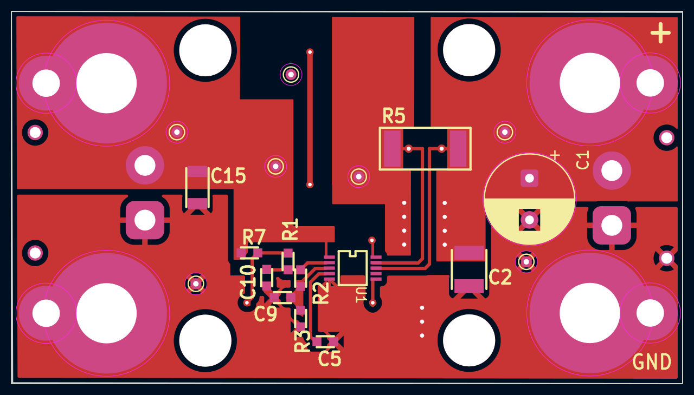
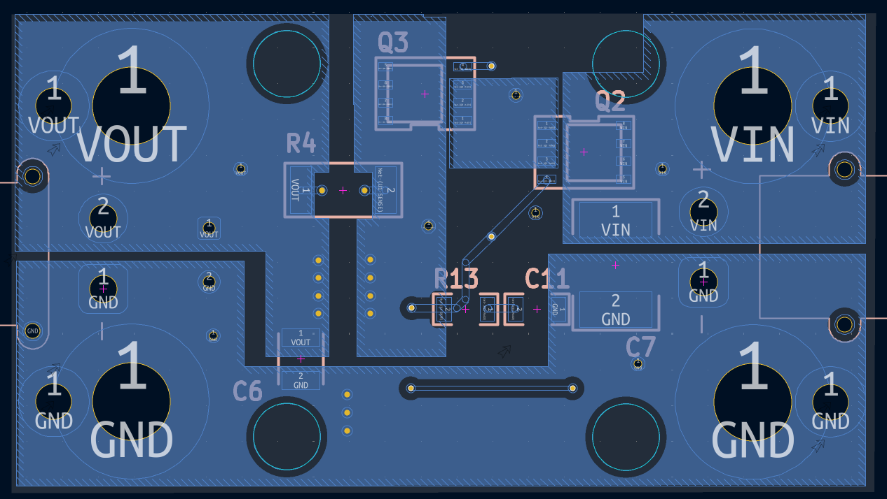

# DC2418-LVC — 2S LiPo/LiHV Low-Voltage Cutoff & Protection Board

An inline protection board for replacing 2S NiMH/NiCd packs with 2S LiPo/LiHV, built around the
Analog Devices **LTC4368-1**. NiMH tolerates being run flat; LiPo/LiHV does not. This board adds
the low-voltage cutoff those older packs never needed, plus reverse-battery and bidirectional
overcurrent protection, between the battery and the existing load.

Pack-total sensing on the two main leads only — cell balancing is handled by the charger via the
balance lead. Adapted from the ADI **DC2418A** demo board, rescaled from 24 V / 10 A to a 2S
(6.0–8.7 V) pack.

| Front (F.Cu) | Back (B.Cu) |
|---|---|
|  |  |

Board outline **60.0 × 33 mm**, 2 layers, XT30PW-M (VIN) and XT30PW-F (VOUT) horizontal
connectors, 4× M2.5 and 4× M5.5 mounting holes.

## Features

- Under-voltage cutoff (LVC), over-voltage backstop
- Bidirectional overcurrent circuit breaker (fast, resettable)
- Reverse-battery protection (back-to-back N-FETs)
- ~4–10 µA quiescent; enable pin can be switched for µA-level off
- Auto-retry or latch-off, selectable by the RETRY cap

## Specifications (as configured)

| Parameter | Value | Set by |
|---|---|---|
| Battery | 2S LiPo / LiHV (7.4 / 7.6 V nom) | — |
| Input range | 6.0 – 8.7 V (chip: 2.5–60 V) | — |
| Under-voltage cutoff | 6.36 V (3.18 V/cell) under load | R7/R1/R2/R3 |
| Over-voltage cutoff | ~9.9 V | R7/R1/R2/R3 |
| Overcurrent trip | ~42 A fwd & rev | R4 = 1.2 mΩ |
| OC response | Auto-retry (~1.3 s) | C5 = 0.22 µF |
| Quiescent | ~4–10 µA (op), <3 µA (shutdown) | — |

Thresholds are ratios against the LTC4368's 0.5 V references, so only ratios matter:

```
V_UV   = 0.5 x (R7+R1+R2+R3) / (R2+R3)   -> 6.36 V
V_OV   = 0.5 x (R7+R1+R2+R3) / R3        -> 9.9 V
I_trip = 0.050 / R4                       -> ~42 A at 1.2 mohm
```

For 3.0 V/cell set `V_UV = 6.0 V`; for a different breaker point `R4 = 0.050 / I_trip`.

## Repository contents

```
DC2418-LVC/                 KiCad project + Gerbers (connectors as drawn)
  DC2418A-2.kicad_sch / .kicad_pcb / .kicad_pro
  DC2418A-2-*.gbr / *.drl / *-job.gbrjob    Fabrication outputs (Gerber X2 + Excellon)
DC2418-LVC-variant/         Electrically identical; XT30 connectors to the side
  LVC.kicad_sch / .kicad_pcb / .kicad_pro
  LVC-*.gbr / *.drl / *-job.gbrjob          Fabrication outputs
BOM.csv                     LCSC-referenced bill of materials
front.png / back.png        Layout views of DC2418-LVC
```

## Bill of materials

| Ref | Value / Part | Package | Notes |
|---|---|---|---|
| U1 | LTC4368CMS-1 | MSOP-10 | Use **I**-grade (LTC4368IMS-1) for sub-zero use |
| Q2, Q3 | SiR870ADP (or IRLR7843 in DPAK) | PDFN-8 5×6 | Back-to-back N-FETs; PDFN has a thermal pad |
| R4 | **1.2 mΩ ≥1 W, alloy/current-sense** | 2512 | Overcurrent set point — must be a metal-element part |
| R7 | 649 kΩ 1% | 0603 | Divider (SHDN tap) |
| R1 | 1.18 MΩ 1% | 0603 | Divider (UV tap) |
| R2 | 56.2 kΩ 1% | 0603 | Divider (OV tap) |
| R3 | 100 kΩ 1% | 0603 | Divider (bottom) |
| R13 | 22 kΩ | 1206 | Gate inrush resistor |
| C11 | 3.3 nF | 1206 | Gate inrush cap (soft-start) |
| C5 | 0.22 µF | 0603 | RETRY → auto-retry (GND = latch-off) |
| C15 | 1 µF | 1206 | VIN bypass (place at the pin) |
| C7 | 4.7 µF (optional) | 2220 | Input bulk cap |
| C1 | 47 µF ≥25 V | THT radial, **D8.0 mm body / 3.5 mm pitch** | Output bulk cap — footprint is `CP_Radial_D8.0mm_P3.80mm` |
| C2, C6 | 4.7 µF | 1210 | Output caps |

Divider values are E96 1%. Cap voltage ratings are inherited 100 V parts; **25 V is sufficient**
for a 2S pack.

> **Not in the BOM:** the **XT30 connectors are not listed** — both boards place an
> `AMASS_XT30PW-M` (VIN) and an `AMASS_XT30PW-F` (VOUT), source them separately. The
> bidirectional **TVS** recommended under [Usage](#usage) is also not listed.
>
> **Do not populate:** **R5** (2512) — the DC2418A's version-option pair with R4. On the **-A**
> build, R4 is the live sense position (1.2 mΩ); R5 is the **-B**'s 0.02 Ω slot. Verified: R4 and
> R5 bridge the same two nodes (`VOUT` ↔ `Net-(U1-SENSE)`), i.e. **parallel alternates, not in
> series** — so leaving R5 empty is harmless. Also `C9` and `C10`, both marked `OPT`.

## Build notes

- **2-layer board.** Keep VIN → Q2 → Q3 → R4 → VOUT short and wide; **2 oz copper** on that path.
- **Kelvin-sense R4:** route SENSE and VOUT to the resistor's own pads, not the current trace.
- **Q2/Q3 PDFN** have a bottom thermal pad — need hot-air/reflow with paste, not an iron. Swap to
  DPAK (IRLR7843) for iron/heat-gun assembly (footprint changes; keep sources common, drains out).
- Before power-up, net-highlight two nets: the **FET common-source node** (both sources, not a
  drain) and the **UV/OV tap order** (UV taps *above* OV).

## Usage

- Wire **battery → VIN/GND** and **VOUT/GND → the existing load input** (not across a motor directly).
- Fit a **bidirectional TVS across VOUT–GND** to clamp the inductive kick when the breaker opens.
- **Charge externally** on a balance charger set to the right chemistry (LiHV vs LiPo). Never charge
  through this board — it does not charge or balance.

## ⚠️ Safety

Discharge-side protection only. LiPo/LiHV is hazardous if abused — charge on a proper balance
charger in a fireproof location, never unattended. Provided **as-is, without warranty**; verify in
your own application.

## Provenance & license

Topology adapted from Analog Devices' **DC2418A** demo board for the LTC4368; independently
re-drawn schematic and layout, not affiliated with or endorsed by ADI.

Hardware (schematics, layout, Gerbers): **[CERN-OHL-S-2.0](LICENCE)** — strongly reciprocal.
Documentation (this README, BOM, images): **[CC-BY-4.0](LICENSE-docs)**.
